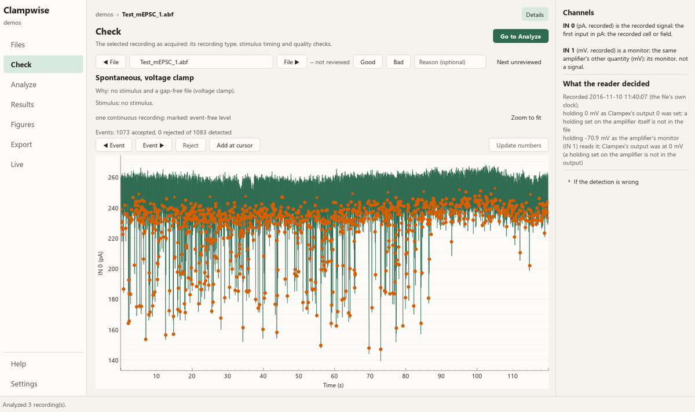
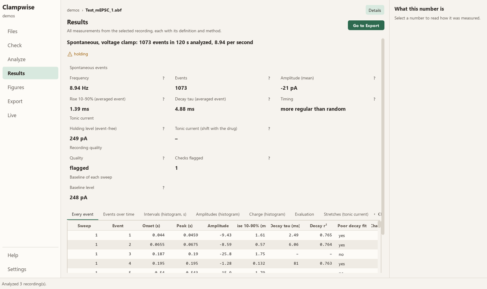
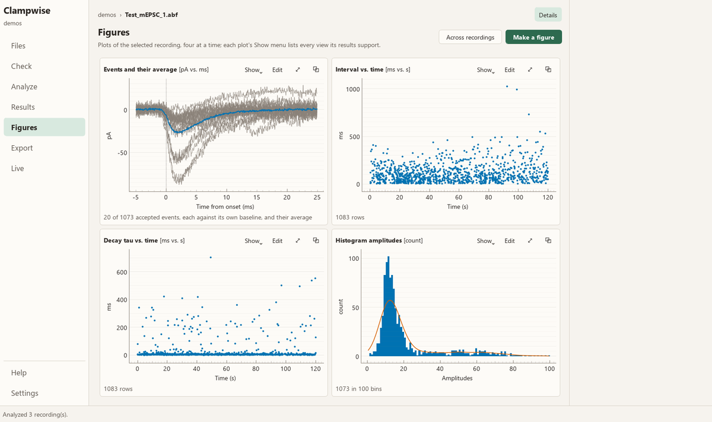

# Clampwise

Analysis for slice electrophysiology — whole-cell patch clamp and field recordings — as a Windows desktop program.
Open a folder of recordings and Clampwise works out what each one is, runs the analyses that fit it, and shows every
number with how it was measured. On a rig it can also watch the experiment live, and record without Clampex.



## What it does

- **Reads** Axon ABF (ABF1 and ABF2) and ATF files, WinLTP sweep files and spike-time files.
- **Recognises each recording from its content**: a current-step family, an evoked response (electrical or light),
  spontaneous events, a DSI/DSE protocol, a membrane test, voltage steps, a field recording. The reason is shown and
  can be overridden.
- **Analyses**: intrinsic properties and firing; I–V curves; evoked responses pulse by pulse (paired pulses, trains,
  failures, kinetics); spontaneous events with template detection and review; DSI/DSE; tonic current; membrane test
  (Rs, Rm, Cm); series-resistance error; bridge balance; field potentials and LTP; short-square and ramp thresholds;
  spike trains; recording quality.
- **Every measurement is documented**: its definition, the window or pulse it came from, its source in the
  literature, and a flag where something looks wrong. Flags never change or exclude a value.
- **Check, correct and review**: drag a measured point to remeasure it, accept or reject events one at a time, mark
  files good or bad. Every decision is kept in the project and can be undone.
- **Figures**: standard graphs for each analysis, heat maps, comparisons across recordings and groups with statistics,
  and a figure builder with presets. **Export** to an Excel workbook (each column's definition attached) or CSV.
- **Projects**: the analysis is saved beside the recordings, so work resumes where it was left; cells, slices and
  conditions are read from folder names or entered by hand.





## Install

1. Download `Clampwise-windows.zip` from the [latest release](https://github.com/Du5ty0311/Clampwise/releases/latest).
2. Unzip it anywhere (for example `C:\Program Files\Clampwise` or your Desktop).
3. Run `Clampwise\Clampwise.exe`. Windows may warn that the program is from an unknown publisher (it is not
   code-signed): choose **More info → Run anyway**.

Requirements: Windows 10 or 11, 64-bit. No Python or other installation is needed.

**Updating.** From version 1.1 on, Clampwise checks for a new version when it starts and offers it under
**Settings → Updates**: one click downloads it, checks it against GitHub's checksum, and replaces the program
(projects and settings are kept). Copies of 1.0.0 need the new zip downloaded once by hand.

To look around first, choose **Open the demos** on the Files screen: three public test recordings from NeuroExpress
(a current-step family, a spontaneous-event recording and a spike train).

## Quick start

1. **Files** — open a folder of recordings (Ctrl+O). Each recording's type is found from its content and its
   analyses run in the background.
2. **Check** — the trace, the stimulus, the measured points and the quality flags, file by file (J / K for the
   previous and next file; G / B to mark it good or bad).
3. **Results** — every measurement, each with its definition and method. **Figures** — graphs, four at a time, or
   across recordings. **Export** — an Excel workbook for the whole project.

**Help** inside the program describes every screen, analysis, setting and measurement, with its references.

## On the rig: Live (optional)

The **Live** screen brings the experiment onto one screen while you record: the amplifier's readings, the cell's
health (Rs, Rm, Cm, holding, noise), each new recording analysed as soon as it is written, and the rig's own programs
shown in place. On a rig with the hardware below, Clampwise can also:

- **record without Clampex**: play your Clampex protocols on the Digidata (Play, Pause, Record), drawing each sweep
  live, into ABF files that Clampex, Clampfit and pyabf open;
- find the **digitizer, amplifier and camera by itself**, and say which program is using each;
- run a **membrane test** that follows Clampex's own algorithm;
- **control the amplifier** (mode, holding, seal test, compensation, Auto buttons), with MultiClamp Commander still
  usable beside it;
- edit a protocol's epochs in a **simple stimulus editor** (always saved under a new name);
- use a Lumenera **camera** without Infinity Analyze, at its full frame rate, with tools for patching and a scale
  bar that follows the objective in use.

Tested with: Digidata 1440A and pCLAMP 10.7, MultiClamp 700B with Commander 2.2, Lumenera INFINITY camera with
Infinity Analyze, Windows 10. pCLAMP and MultiClamp Commander must be installed (Clampwise uses their own libraries);
Clampex must be closed while Clampwise records, as only one program can hold the Digidata.

> Recording and amplifier control drive real hardware connected to a living cell. Try them first on a model cell,
> and keep MultiClamp Commander open to see and override what Clampwise sets.

## How it was validated

The analyses are checked against simulated recordings with known answers (186 measures, all within tolerance), and
the acquisition against Clampex and Axon's own file library on a model cell. See [docs/VALIDATION.md](docs/VALIDATION.md)
for the methods, the numbers, and what is not yet verified.

## Running from source

```
pip install -e .[dev]          # Python 3.12
python -m clampwise.app [FOLDER]
```

Tests: `python -m pytest -q tests` (set `QT_QPA_PLATFORM=offscreen` on a machine without a display). Tests that need
real recordings look for the demo files under `CLAMPWISE_DEMOS` and for a lab's own recordings under the folders
`CLAMPWISE_LAB_DATA` names (separated by `;`); without them those tests are skipped. Known answers:
`python tools/audit/known_answers.py`.

Recording from source needs a 32-bit Python for the Digidata's 32-bit library: unzip python.org's 32-bit
embeddable Python 3.12 into `%LOCALAPPDATA%\Clampwise\py32` (the built program ships it).

### Building the program

```
powershell -ExecutionPolicy Bypass -File packaging\build.ps1
```

produces `dist\Clampwise` and `dist\Clampwise-windows.zip`, and ends with the built program's own self-test. It needs
the NeuroExpress test recordings (`CLAMPWISE_DEMOS`) to bundle as the demos, and downloads and checks the 32-bit
embeddable Python.

### Publishing a new version

Describe it in `CHANGELOG.md` under `## <version>`, commit on `main`, then:

```
powershell -ExecutionPolicy Bypass -File packaging\release.ps1 -Version 1.1.1
```

It sets the version, builds and checks the program (tests and self-test), commits, tags and pushes, and makes the
GitHub release with the zip; every copy of Clampwise then offers the update.

### Layout

- `src/clampwise/io` — readers (ABF, ATF, WinLTP, spike times)
- `src/clampwise/analysis` — the analyses, each registered with its settings, outputs and sources
- `src/clampwise/figure` — figure recipes, statistics, rendering, presets
- `src/clampwise/project` — the project store, notes, sessions, rigs, health
- `src/clampwise/rig` — the rig: Commander's readout and telegraph, the amplifier's controls, the Digidata, the
  camera, Clampex's Lab Book
- `src/clampwise/app` — the PyQt5 interface
- `tests`, `tools/audit/known_answers.py`, `tools/rig` (command-line recording and validation tools)

## Licence

Copyright © 2026 Daniel Mercado. Clampwise is free software: you can redistribute it and modify it under the terms of
the [GNU General Public License, version 3](LICENSE). It is distributed in the hope that it will be useful, but
WITHOUT ANY WARRANTY; without even the implied warranty of MERCHANTABILITY or FITNESS FOR A PARTICULAR PURPOSE. The
rig features drive laboratory hardware; you use them at your own risk.

Questions, bug reports and suggestions: [open an issue](https://github.com/Du5ty0311/Clampwise/issues).

## Acknowledgements

The demo recordings are NeuroExpress's public test files (Attila Szűcs). Acquisition follows the method of John
Dempster's WinWCP (University of Strathclyde) for the Digidata 1440A, and the membrane test the pCLAMP 10 User
Guide. ABF reading is checked against pyabf (Scott Harden) and Axon's ABFFIO library. Each analysis names its own
sources in Help.
